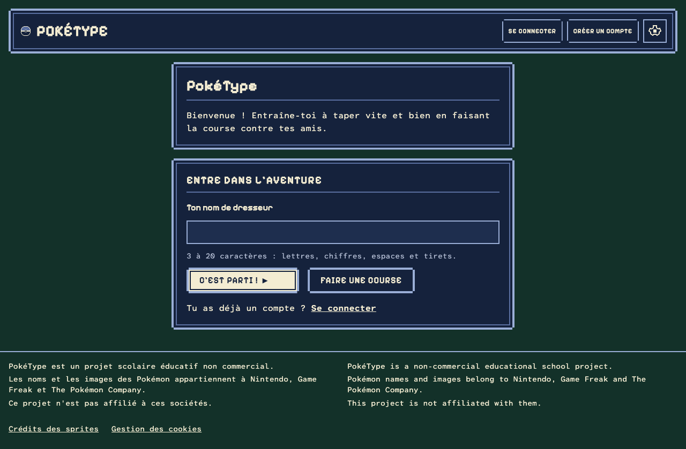
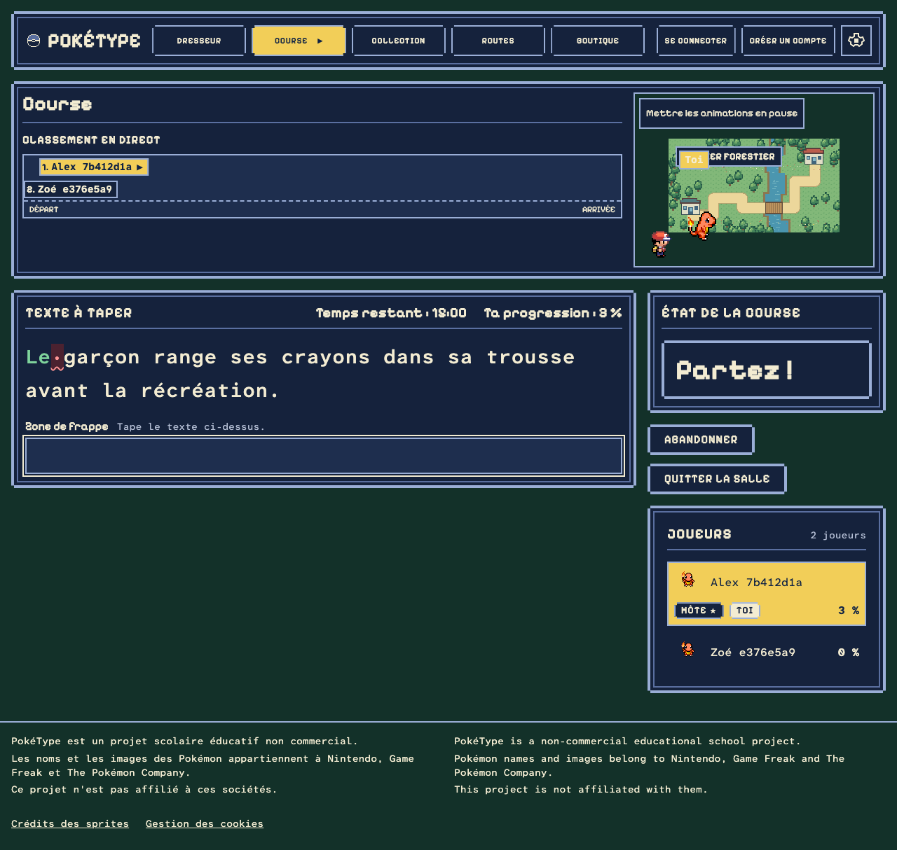
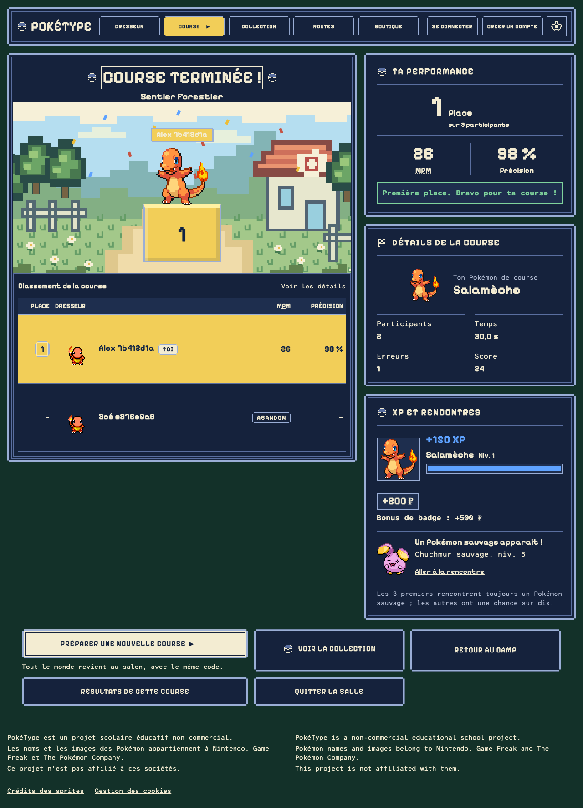

# PokéType

A school project for the Web V course: real-time multiplayer typing races for players aged 10–12 practising French and English. Each player races a Pokémon along a top-down route, earns XP by final place, evolves it, and grows a collection through post-race encounters. Rooms, races, results and rewards are decided by the server; players race from their own browsers, alone against bots or against each other.

**Production:** https://poketype-eight.vercel.app

**Demo account:** username `ash`, password: see the teacher hand-in note. `ash` holds every Pokémon and all eight badges. You can also enter as a guest with any trainer name, or create an account in a few seconds.

| Home | Race | Results |
| --- | --- | --- |
|  |  |  |

More screens (waiting room, trainer hub, sign-up, log-in) are in [docs/design-captures](docs/design-captures/). They are regenerated by `tests/e2e/theme-switch.spec.ts`.

## Technologies

| Technology | Role |
| --- | --- |
| Next.js 16 (App Router) | Pages, server actions and API routes; server rendering |
| React 19 | Interface components |
| TypeScript (strict) | All application code; no application JavaScript |
| Tailwind CSS 4 | Styling, with the retro component kit in `src/components/pixel/` |
| PostgreSQL 18 | Rooms, races, accounts, sessions, collection and reward ledger |
| Drizzle ORM and drizzle-kit | Typed queries, schema in `src/server/db/schema.ts`, SQL migrations in `drizzle/` |
| Zod 4 | Validation of every request body and form at the server boundary |
| Pusher Channels (Soketi locally) | Live room and race updates by push; the app falls back to polling without it |
| next-intl | French (default) and English interface |
| Vitest | Unit tests (`tests/unit/`) |
| Playwright | End-to-end tests in real browsers (`tests/e2e/`), including multi-browser races |
| GitHub Actions | CI: lint, typecheck, unit and E2E tests on every pull request |
| Vercel and Neon | Hosting over HTTPS and the managed production database |

## Local installation

Requires Node 24 (`nvm use` reads `.nvmrc`), npm, and Docker.

1. `npm ci`
2. `cp .env.example .env`. The placeholders work as they are with Docker Compose.
3. `docker compose up -d`. It starts PostgreSQL 18 on port 5432, with the `poketype` and `poketype_test` databases, and Soketi, the local push server, on port 6001. Stop any local PostgreSQL first.
4. `npm run db:migrate` and `npm run db:migrate:test`
5. `npm run db:seed` creates the demo accounts Maya (`Bulbizarre-Maya-26`) and Leo (`Salameche-Leo-26`), each with a starter, and the account `ash` with all 151 Pokémon and every badge when `SEED_ASH_PASSWORD` is set. Running it again is safe.
6. `npm run dev`, then open http://localhost:3000.

Without Docker, a local PostgreSQL works too: `createdb poketype` and `createdb poketype_test`, then edit both URLs in `.env` (for example `postgres://YOUR_USER@localhost:5432/poketype`). Without Soketi the app works by polling, but remove every `PUSHER_*` line from `.env`: setting only some of them fails the build, and the push E2E specs need Soketi.

## Environment variables

`.env.example` lists every variable with a placeholder; real values never go in Git.

| Variable | Purpose |
| --- | --- |
| `DATABASE_URL` | PostgreSQL connection for the app (on Vercel, the pooled Neon URL) |
| `DATABASE_URL_UNPOOLED` | Production only: direct Neon connection used by migrations during the Vercel build; falls back to `DATABASE_URL` |
| `TEST_DATABASE_URL` | Database used by the E2E tests, which reset and seed it |
| `POSTGRES_USER`, `POSTGRES_PASSWORD` | Credentials Docker Compose gives the local PostgreSQL |
| `E2E_PORT` | Optional port of the E2E app server (default 3100) |
| `SEED_ACCOUNTS` | Optional: set to `allow` to let the seed write to a non-local database |
| `SEED_ASH_PASSWORD` | Password of the seeded `ash` account (8 to 128 characters); without it, the seed skips `ash` |
| `PUSHER_APP_ID`, `PUSHER_KEY`, `PUSHER_SECRET` | Push app credentials (Soketi locally, Pusher Channels in production); leave all `PUSHER_*` unset for polling only |
| `PUSHER_HOST`, `PUSHER_PORT`, `PUSHER_USE_TLS` | Local Soketi address |
| `PUSHER_CLUSTER` | Production Pusher cluster (for example `us2`), set instead of the three above |

## Tests

| Command | What it runs |
| --- | --- |
| `npm run lint` | ESLint, including the rules that refuse hard-coded visible text |
| `npm run typecheck` | Strict TypeScript check |
| `npm test` | Vitest unit tests |
| `npm run build` then `CI=1 npm run test:e2e` | Playwright E2E tests against the test database, with Soketi running |

## Deployment on Vercel

The app runs on Vercel (Hobby plan) with a Neon database and a Pusher Channels app, all in the US East region.

1. Import the GitHub repository in Vercel. `vercel.json` pins functions to `iad1` (Washington, next to Neon `aws-us-east-1`).
2. In the Vercel project, open Storage and connect a Neon database in `us-east-1`. This sets `DATABASE_URL` (pooled) and `DATABASE_URL_UNPOOLED`.
3. Create the Pusher Channels app as described below (cluster `us2`) and set `PUSHER_APP_ID`, `PUSHER_KEY`, `PUSHER_SECRET` and `PUSHER_CLUSTER` for Production and Preview.
4. Set `SEED_ASH_PASSWORD` (8 to 128 characters) to create the `ash` account on each deployment; leave it unset to skip.
5. Deploy. Vercel runs `npm run vercel-build` (`scripts/vercel-build.ts`) instead of `npm run build`, in this order: apply migrations over `DATABASE_URL_UNPOOLED` (falling back to `DATABASE_URL`), seed `ash` when `SEED_ASH_PASSWORD` is set, then `next build`. Preview deployments (pull requests) only build: they share the production database, so an unmerged branch never migrates it. A failed migration fails the deployment and the previous version stays live. The build itself never connects to the database: the connection opens on the first query.
6. To redeploy without a code change, use Redeploy on the deployment in Vercel, or push a commit.

### Test account `ash` in production

`ash` is a normal account holding every Pokémon and badge, for demonstrations. To create it in the deployed database, set `SEED_ASH_PASSWORD` (8 to 128 characters) in Vercel and run the seed once against the production URL: `DATABASE_URL=<production url> SEED_ASH_PASSWORD=<password> npm run db:seed`. Against a remote database the seed creates only ash, never Maya or Leo. Keep the password out of Git.

### Production push service

The deployed app needs a Pusher Channels app; nothing in the repository creates it.

1. Create a free Pusher account and a Channels app (Sandbox plan) in the cluster nearest the database, for example `eu`. Leave client events disabled (the default).
2. In the Vercel project, set `PUSHER_APP_ID`, `PUSHER_KEY`, `PUSHER_SECRET` and `PUSHER_CLUSTER` for Production and Preview, then redeploy: the CSP is built from them. Do not set `PUSHER_HOST`, `PUSHER_PORT` or `PUSHER_USE_TLS` there.
3. Keep the secret out of Git; `.env.example` holds placeholders only.

## Commands

| Command | Purpose |
| --- | --- |
| `npm run dev` / `npm run build` / `npm start` | Development server, production build, production server |
| `npm run typecheck` | Strict TypeScript check |
| `npm run lint` | ESLint, including rules that flag hard-coded visible strings (see the limits in `docs/DECISIONS.md`) |
| `npm test` | Vitest unit tests |
| `npm run db:generate` | Generate a migration after editing `src/server/db/schema.ts` |
| `npm run db:migrate` / `npm run db:migrate:test` | Apply migrations to the development / test database |
| `npm run db:seed` / `npm run db:seed:test` | Create the demo accounts Maya and Leo if missing (local databases only unless `SEED_ACCOUNTS=allow`) and `ash` when `SEED_ASH_PASSWORD` is set; the e2e run seeds the test database itself |
| `npm run test:e2e` | Playwright tests against the test database (run `db:migrate:test` and, for CI parity, `build` first; set `CI=1` to use `next start`; `E2E_PORT` sets the app port, default 3100; the outage and push-fallback tests start extra servers on the next ports; Soketi must be running) |

CI (`.github/workflows/ci.yml`) runs the same steps on every pull request against a fresh PostgreSQL and Soketi.

User-facing text lives in `messages/fr.json` and `messages/en.json`; never write it in a component.

Pages that share the site header live in the `src/app/(site)/` route group (the folder name does not appear in URLs); its layout renders the skip link and header. Build screens from the retro component kit in `src/components/pixel/` and the tokens in `src/app/globals.css`; the rules are in [docs/design.md](docs/design.md).

## How work happens

Development runs through Claude Code. `CLAUDE.md` holds the project context; the backlog lives on the GitHub project board as epics and stories with Given/When/Then criteria, groomed from `docs/REQUIREMENTS.md`. Each story lands as a series of small commits, one per working step, through a pull request that CI checks.

## Documentation

- [Original school brief](docs/source/cahier-des-charges.docx) and [searchable extraction](docs/source/cahier-des-charges-extracted.md).
- [Requirement traceability matrix](docs/EXIGENCES.md): every Web V requirement with its status, files and tests.
- [Requirement checklist](docs/REQUIREMENTS.md), with every requirement ID and school priority.
- [Decisions and open questions](docs/DECISIONS.md).
- [French accents and keyboards](docs/keyboards.md): Unicode form, dead keys and the tested keyboards.
- [Pokémon progression rules](docs/PROGRESSION.md): XP by place, level table, starters, wild encounters, PC boxes, legendaries.
- [Visual guide and mockups](docs/design/README.md).
- [Architecture proposal](docs/ARCHITECTURE.md), [milestones](docs/IMPLEMENTATION_PLAN.md) and [acceptance checks](docs/ACCEPTANCE.md).

## Approved direction

Fully retro handheld-game design (the modern-card alternative was rejected). Pokémon race on a shared top-down winding route. Players pick a starter from ten, earn XP by final place, evolve through sustained play, and catch new Pokémon from wild encounters after races, with Poké Balls bought in the shop. Species and evolution never grant typing-speed advantages.

The five mockups are concept references: build real components, text and state, never screenshots.

## Legal notice

PokéType is a non-commercial school project made for educational purposes. It has no ads, payments or revenue. Pokémon and all related names, characters and images are trademarks of Nintendo, Game Freak and The Pokémon Company. This project is not affiliated with or endorsed by them.
