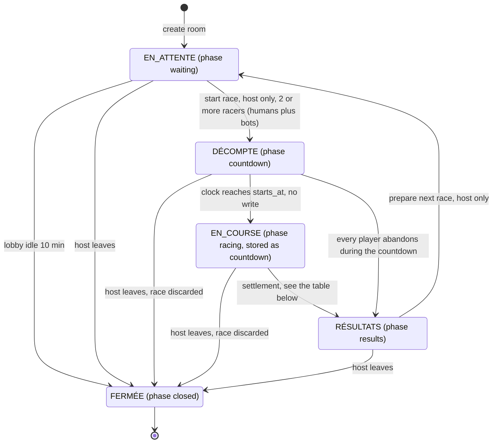

# Architecture

How PokéType is built, for a reader who has not seen the code. Every diagram below was checked against `main`; when code and diagram disagree, the code wins and the diagram is a bug. Decisions and their history live in [DECISIONS.md](DECISIONS.md); the school brief is summarised in [REQUIREMENTS.md](REQUIREMENTS.md).

Contents: [Stack and layout](#stack-and-layout) · [Data model](#data-model) · [Room and race state machine](#room-and-race-state-machine) · [Real-time flow](#real-time-flow) · [ADR 1: real-time technology](#adr-1-real-time-technology) · [ADR 2: bot management](#adr-2-bot-management) · [Gaps against the assignment](#gaps-against-the-assignment)

## Stack and layout

Next.js App Router, React, strict TypeScript, Tailwind CSS and PostgreSQL (mandated, TECH-1), with Drizzle as the ORM. The app runs on Vercel with a Neon database and a managed Pusher Channels app. Local runs and CI use `docker-compose.yml` (PostgreSQL and Soketi).

| Folder | What lives there |
| --- | --- |
| `src/app/` | Pages and route handlers (`src/app/api/rooms/[roomId]/...` are the room commands). |
| `src/domain/` | Pure functions and types with no I/O: phases, scoring, progress judging, bot typing, XP. |
| `src/server/` | Everything that touches PostgreSQL or Pusher: `rooms/` (commands, snapshot, settlement), `push/`, `trainer/`, `accounts/`, `sessions/`. |
| `src/features/` | Client components and hooks, grouped by feature (`rooms/live/` follows a room, `race/` types and reports). |
| `src/config/game.ts` | Every tuning value (timings, speed caps, capacity, bot levels) in one typed object. |

## Design rules

- The server is authoritative. It owns host identity, membership, settings, the text snapshot, start time, deadline, results and rewards. A client never sends a winner, XP or a drop.
- Every room command runs in one transaction that first locks the room row (`lockRoom`, `SELECT ... FOR UPDATE`), so joins, starts, progress and settlement are serialised per room.
- Every committed change bumps `rooms.revision`. Clients compare revisions to drop stale answers.
- No background job exists. Time-based changes (race deadline, idle lobby close) are applied by the first request that sees them, once, under the room lock.
- Rewards settle exactly once per race participant: the XP, coin, encounter and badge tables have unique keys on the participant, and a refreshed results page reads them.
- Race movement depends only on typing progress; species and evolution give no speed advantage.

## Data model

All 23 tables of `src/server/db/schema.ts`. Only keys and the columns that explain a table are drawn; the schema file holds every column and `check` constraint. A trainer's identity is the `guests` row: an account (`users`) points at its guest, so everything a guest owned stays theirs when they sign up.

```mermaid
erDiagram
    guests ||--o| users : "becomes (users.guest_id unique)"
    users ||--o| password_credentials : "has"
    guests ||--o{ sessions : "holds"
    users ||--o{ sessions : "signed in as (user_id, guest_id)"
    guests ||--o{ rooms : "hosts"
    guests ||--o{ room_code_failures : "mistyped codes"
    rooms ||--o{ room_members : "seats"
    guests ||--o{ room_members : "joins"
    rooms ||--o{ room_removals : "removed from"
    guests ||--o{ room_removals : "was removed"
    rooms ||--o{ room_bots : "seats"
    rooms ||--o{ races : "runs"
    races ||--o{ race_participants : "has players"
    guests ||--o{ race_participants : "races as"
    owned_pokemon |o--o{ race_participants : "partner (set null)"
    races ||--o{ race_bots : "has bots"
    guests ||--o{ owned_pokemon : "owns"
    guests ||--o{ earned_badges : "earns"
    races |o--o{ earned_badges : "granted by"
    race_participants ||--o| xp_grants : "granted once"
    guests ||--o{ coin_entries : "wallet ledger"
    race_participants |o--o{ coin_entries : "race payout"
    guests ||--o{ bag_items : "bag"
    guests ||--o{ stone_evolutions : "evolves by item"
    guests ||--o{ wild_encounters : "meets"
    race_participants ||--o| wild_encounters : "queued once"
    wild_encounters ||--o{ encounter_throws : "balls thrown"
    guests ||--o{ legendary_grants : "earns"
    races |o--o{ legendary_grants : "granted by"
    guests ||--o{ released_pokemon : "released"

    guests {
        uuid id PK
        text trainer_name
        int coins "check >= 0"
        int pc_boxes
    }
    users {
        uuid id PK
        text username "unique on lower()"
        uuid guest_id FK "unique"
    }
    password_credentials {
        uuid user_id PK, FK
        text password_hash "scrypt"
    }
    login_failures {
        uuid id PK
        text username_key "no FK, indexed with failed_at"
        timestamptz failed_at
    }
    sessions {
        uuid id PK
        text token_hash UK
        uuid guest_id FK
        uuid user_id FK "composite with guest_id"
        timestamptz expires_at
    }
    rooms {
        uuid id PK
        uuid host_guest_id FK
        text code UK
        text visibility
        text phase "waiting, countdown, racing, results, closed"
        int revision
        text close_reason "host-left, idle"
        timestamptz last_activity_at
    }
    room_code_failures {
        uuid id PK
        uuid guest_id FK
        timestamptz failed_at
    }
    room_members {
        uuid id PK
        uuid room_id FK
        uuid guest_id FK "unique with room_id"
    }
    room_removals {
        uuid room_id PK, FK
        uuid guest_id PK, FK
        timestamptz removed_at
    }
    room_bots {
        uuid room_id PK, FK
        text character PK
        text level
    }
    races {
        uuid id PK
        uuid room_id FK
        text passage "text snapshot"
        timestamptz starts_at
        timestamptz deadline_at
        timestamptz ended_at "null until settled"
        int rules_version
    }
    race_participants {
        uuid race_id PK, FK
        uuid guest_id PK, FK
        int position
        int keystrokes
        int last_sequence
        timestamptz finished_at
        timestamptz abandoned_at
        timestamptz inactive_at
        int place "null until settled"
        uuid partner_pokemon_id FK
    }
    race_bots {
        uuid race_id PK, FK
        text character PK
        int seed "drives the typing"
        int place "null until settled"
    }
    owned_pokemon {
        uuid id PK
        uuid guest_id FK
        int dex
        int level
        int xp
        bool is_partner "one per guest (partial unique)"
    }
    earned_badges {
        uuid guest_id PK, FK
        text badge PK
        uuid race_id FK
    }
    xp_grants {
        uuid race_id PK, FK
        uuid guest_id PK, FK
        int xp
        int dex_before
        int dex_after
    }
    coin_entries {
        uuid id PK
        uuid guest_id FK
        text reason "race, badge, purchase, seed"
        int amount
        uuid race_id FK "with guest_id to race_participants"
        uuid purchase_key "unique per guest"
    }
    bag_items {
        uuid guest_id PK, FK
        text item PK
        int quantity
    }
    stone_evolutions {
        uuid id PK
        uuid guest_id FK
        text stone "evolution item"
        int dex_before
        int dex_after
    }
    wild_encounters {
        uuid id PK
        uuid guest_id FK
        uuid race_id FK "unique with guest_id"
        int dex
        text status
        int throws_used
    }
    encounter_throws {
        uuid encounter_id PK, FK
        int throw_number PK
        bool caught
    }
    legendary_grants {
        uuid guest_id PK, FK
        int dex PK
        uuid race_id FK
        timestamptz claimed_at
    }
    released_pokemon {
        uuid id PK
        uuid guest_id FK
        int dex
        int level
    }
```

Things the picture cannot show:

- Bots have no `guests` row. `room_bots` and `race_bots` hang off rooms and races only, so no ledger, badge or session can reference a bot.
- `xp_grants`, `coin_entries` and `wild_encounters` reference `race_participants (race_id, guest_id)` with a composite foreign key. Their unique keys are what make a reward happen once per participant.
- `sessions (user_id, guest_id)` references `users (id, guest_id)`, so a session can never name a user together with someone else's guest.
- `stone_evolutions` keeps its first name in the database; the TypeScript export is `itemEvolutions`.
- `login_failures` has no foreign key on purpose: failures for unknown usernames are throttled under the same key as real ones.

## Room and race state machine

A room moves through five phases, stored in `rooms.phase` (`src/domain/room-phase.ts`). One of them, `racing`, is never written: the race stays stored as `countdown` and `isRaceRunning` treats `countdown` and `racing` alike. EN_COURSE is therefore *derived from the clock* (`now >= races.starts_at`), which is also what `acceptsTypingAt` checks when a progress report arrives.

| State (assignment) | Code phase | Stored in `rooms.phase` |
| --- | --- | --- |
| EN_ATTENTE | `waiting` | `waiting` |
| DÉCOMPTE | `countdown` | `countdown` |
| EN_COURSE | `racing` | `countdown` (derived from the clock) |
| RÉSULTATS | `results` | `results` |
| FERMÉE | `closed` | `closed` (with `close_reason`) |

### Transitions, triggers and guards

| Transition | Trigger (code) | Guards, checked in this order under the room lock |
| --- | --- | --- |
| create → EN_ATTENTE | `createRoom` in `src/server/rooms/room-commands.ts` | The creator becomes host and first member. |
| EN_ATTENTE → DÉCOMPTE | `POST /api/rooms/[roomId]/start`, `startRace` | Room open; caller is a member; lobby not past its idle close; caller is the host; phase is `waiting`; `countRacers` (members plus bots) is at least `gameConfig.race.minimumPlayers` (2). The same transaction draws the text, inserts the `races` row (`starts_at` = request + 1.5 s sync lead + 3 s countdown, `deadline_at` = start + 15 min), copies every member into `race_participants`, every bot into `race_bots` with a fresh seed, and bumps the revision. |
| DÉCOMPTE → EN_COURSE | Time only: `now >= races.starts_at` | None. Progress sent before `starts_at` is answered `not-started` (409). |
| EN_COURSE → RÉSULTATS | `settleRace`, run by whichever request comes first | Either every player has finished, abandoned or been marked inactive (`settleWhenAllFinished`, called after an accepted finishing report or an abandonment), or the deadline has passed (`settleAtDeadline`, called by a late progress report or abandon, or by a snapshot read through `loadRoomSnapshot`). Bots never hold a race open. `endRace` only updates a race whose `ended_at` is null, so settlement happens once. It places players and bots together, grants XP, coins, encounters, badges and legendaries to players only, then sets the phase to `results`. |
| DÉCOMPTE → RÉSULTATS | Last abandonment during the countdown | Same as above; the race counts as ended at `starts_at`, never before. |
| RÉSULTATS → EN_ATTENTE | `POST /api/rooms/[roomId]/prepare`, `prepareNextRace` | Room open; caller is a member; caller is the host; phase is `results`. Abandoners leave the room, the idle clock restarts, bots stay. |
| EN_ATTENTE → FERMÉE (idle) | Any command or read on a waiting room, `closeIfIdle` | Phase is `waiting` and `lobbyIdleOf(last_activity_at)` is past `closeAfterMs` (10 min). `close_reason = idle`. Idle only counts in `waiting`. |
| any open phase → FERMÉE (host) | `POST /api/rooms/[roomId]/leave`, `leaveRoom` | Caller is the host. `close_reason = host-left`. A race still running is discarded with no settlement and no rewards. |

Other commands that do not change the phase: a non-host leaving a waiting room deletes the membership; a non-host leaving during a race becomes an abandonment (`abandonAndStay`); `settings`, `visibility`, `bots` and `remove` only act in `waiting` (the host can also mark a silent racer inactive during a race). A closed room is never shown again: every command answers `not-found`.
