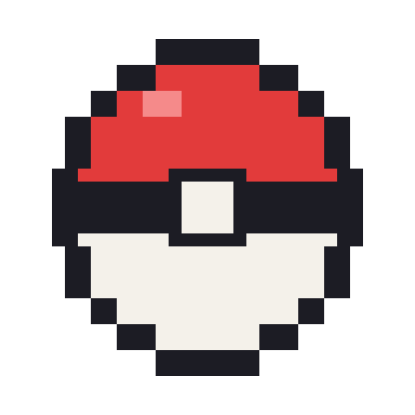

# Démarche créative de PokéType

> Les parties factuelles (palette, typographies, fonctionnement des thèmes) sont tirées du code. Les parties créatives (nom, logo, justification des thèmes) sont écrites par l'étudiant, sans IA, et reproduites telles quelles.

Les images (croquis, logo, moodboard) se déposent dans le dossier `docs/design/demarche/`. Une fois un fichier ajouté, il suffit de l'y référencer, par exemple `docs/design/demarche/croquis-logo-1.png`.

## Nom

### Noms envisagés et raison du choix

Pour ce qui est du nom, mon premier choix était pokéRacer. Je trouvais que ça englobais bien l’esprit global du projet. Cependant, j’ai finalement choisi Pokétype parce que les jeux pokémon ont tous depuis le début englobé l’importance des types de chaque Pokémon.  De plus, le “type” peut être interprété comme le typing au clavier qui est ce dont l’app sert à pratiquer.

### Vérification d'originalité

Lorsqu’on recherche pokeType, un site apparait mais en approfondissant mes recherches, je me suis rendu compte que pas mal tout les jeux de mots avec “Poké” sont pris. De plus, le site qui s’affiche sous pokeType semble être un front non utilisé qui ne sert pas à grand chose.

## Logo

Pour ce qui est des croquis, je n’en ai pas fait. Mon app utilise un style pixelisé qui rappelle les vieux jeux de pokémons. J’ai donc pris une image pixelisé libre de droit comme logo que j’adapte selon le lighting choisi par le user.

### Fichiers

- Source : `public/assets/items/poke-ball.svg` (32 × 32 pixels), affichée à côté du nom dans l'en-tête (`src/components/header/BrandLogo.tsx`).
- Thème sombre : un contour d'un pixel de la couleur `frame` entoure la Poké Ball pour que son contour foncé reste visible (`.brand-logo` dans `src/app/globals.css`).
- Favicon et icône d'écran d'accueil : `src/app/icon.svg`, `src/app/favicon.ico`, `src/app/apple-icon.png`, régénérés avec la copie ci-dessus par `npx tsx scripts/build-favicons.ts`.

## Moodboard

De 3 à 5 références. Les images se déposent dans `docs/design/demarche/`.

À compléter par l'étudiant — sans IA

## Palette

Source : `src/app/globals.css` (bloc `@theme`). Chaque couleur est une paire `light-dark(clair, sombre)` ; une valeur unique s'applique aux deux thèmes. Les rôles sont détaillés dans `docs/design.md`.

| Jeton | Rôle | Thème clair | Thème sombre |
| --- | --- | --- | --- |
| `ink` | Texte du corps, titres, contour de focus, fond du bouton principal | `#102344` | `#f3ecd2` |
| `cream` | Papier des panneaux, texte du bouton principal | `#f6f0d8` | `#15223c` |
| `cream-deep` | Zones en creux : champs, en-tête de tableau, survol, cases de statistiques, piste d'XP | `#e9e0bf` | `#1e2e4e` |
| `sage` | Fond de page derrière les panneaux, pied de page | `#83af84` | `#133129` |
| `frame` | Cadre extérieur de 4 px des panneaux, boutons et emplacements | `#102344` | `#9aaed6` |
| `slate` | Ligne intérieure de 2 px et filets dans les panneaux (décoratif) | `#5b6c8f` | `#5a6fa0` |
| `muted` | Texte secondaire : étiquettes, métadonnées, libellés désactivés | `#46557a` | `#b3bdd3` |
| `gold` | Remplissage de l'élément sélectionné ou courant | `#f2ce58` | `#f2ce58` |
| `on-gold` | Texte et icônes sur les fonds or, argent et bronze (bleu marine fixe) | `#102344` | `#102344` |
| `success` | Caractères tapés correctement, état prêt, variations positives | `#25683f` | `#7fd39c` |
| `error` | Erreurs, caractères faux, actions destructrices | `#a3343a` | `#ff9696` |
| `error-soft` | Fond derrière un caractère faux ou un champ en erreur | `#f7dad4` | `#4b2230` |
| `xp` | Remplissage de la barre d'XP | `#2f6bd1` | `#5ea2ff` |
| `silver` | Médaille et marche du podium, 2e place | `#c3cad6` | `#c3cad6` |
| `bronze` | Médaille et marche du podium, 3e place | `#d08a52` | `#d08a52` |

## Typographies

Source : `src/app/fonts.ts`. Les deux polices sont chargées avec `next/font/google` et exposées par les variables CSS `--font-pixelify` et `--font-atkinson-mono`, rattachées dans `src/app/globals.css` aux familles `font-pixel` et `font-mono`.

| Police | Variable | Où elle est utilisée |
| --- | --- | --- |
| Pixelify Sans | `--font-pixelify` (classe `font-pixel`) | Titres des panneaux (`PixelPanel`), boutons (`PixelButton`), onglets de navigation (`NavTab`), pastilles, grands nombres, tableau de résultats, podium et statistiques du dresseur |
| Atkinson Hyperlegible Mono | `--font-atkinson-mono` (classe `font-mono`) | Police par défaut de la page (`body`), texte courant, données et passage à taper |

## Thèmes clair et sombre

### Fonctionnement

- Les couleurs qui changent selon le thème sont des paires `light-dark(clair, sombre)` dans `@theme` (`src/app/globals.css`). Les composants n'utilisent jamais de couleur `dark:` : ce sont les jetons qui portent le thème.
- Sans réglage, la page suit la préférence du système (`color-scheme: light dark`).
- Le réglage « Clair / Sombre / Système » écrit l'attribut `data-theme` sur `<html>` (`color-scheme: light` ou `dark`). Le choix est conservé dans le stockage local sous la clé `poketype-theme`, et un petit script dans le `<head>` le réapplique avant le premier affichage pour éviter un flash. Le code se trouve dans `src/features/theme/`.
- Le détail et les rapports de contraste sont dans `docs/design.md`.

### Justification

Pour les palettes de couleurs des thèmes sombre et clair, j’ai gardé les couleurs les plus présentes dans les jeux sur la DS et GameBoy. Ainsi, j’essaie de faire ressortir la nostalgie que ces couleurs amènent.
