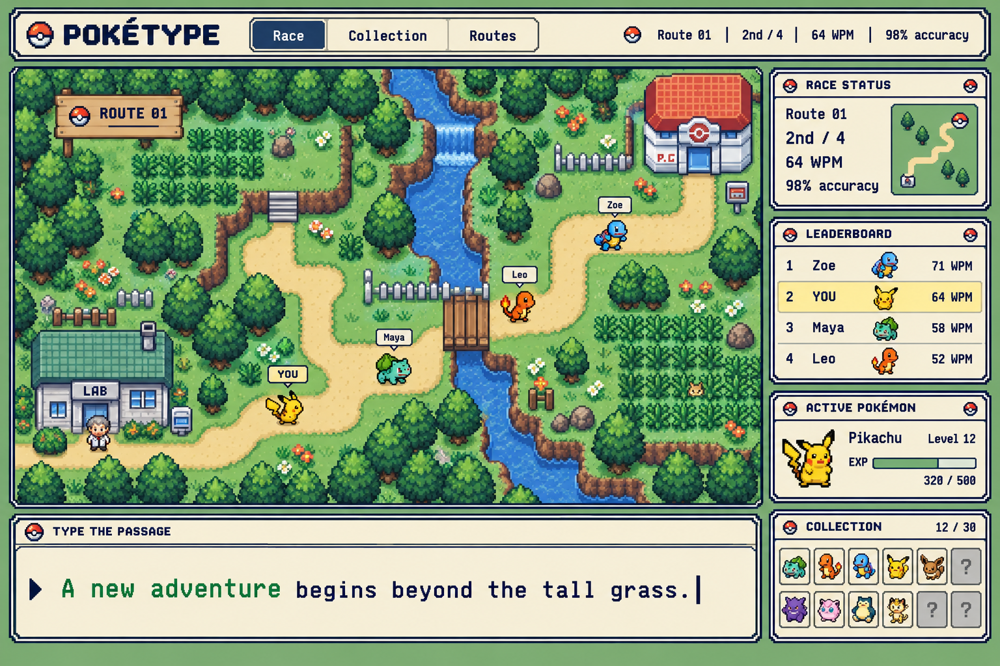
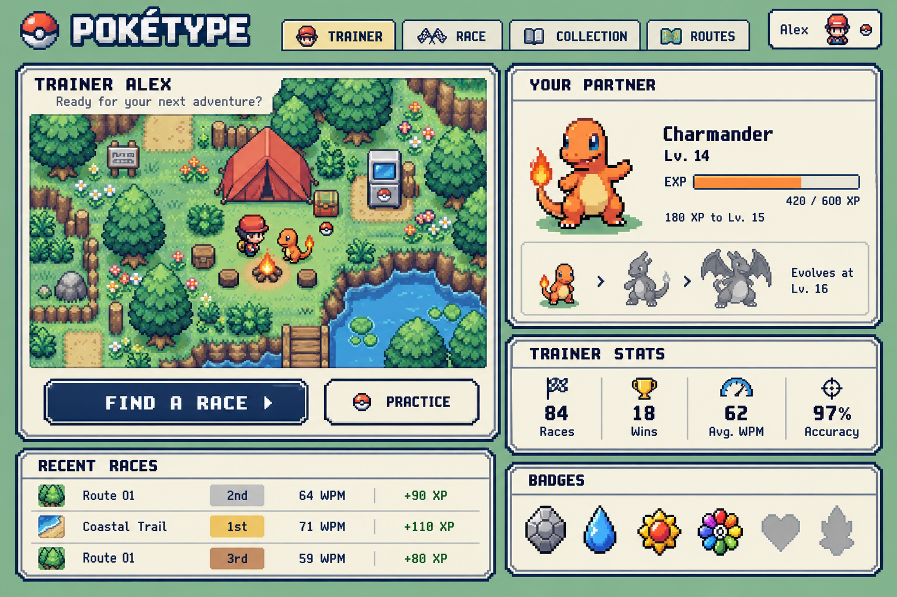
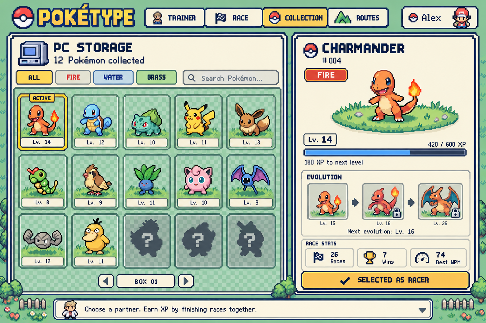
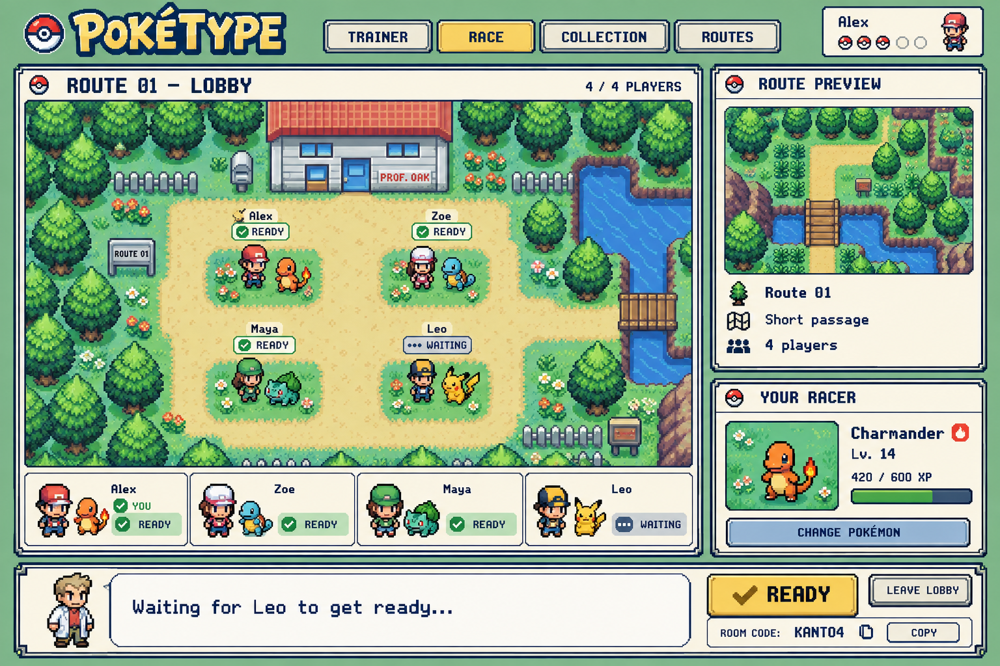
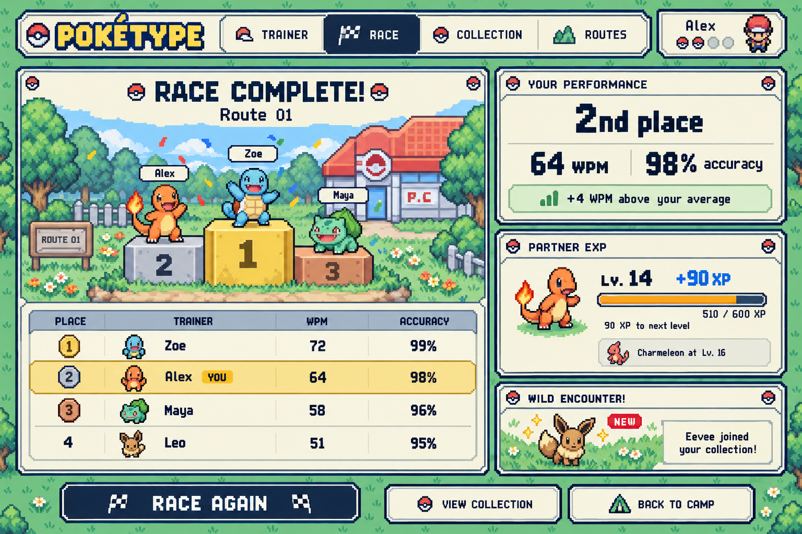

> Implementable direction (tokens, fonts, frames, components, states): [docs/design.md](../design.md). It wins where the notes below disagree.

# Visual direction and screen reference

## Approved visual language

Faithful retro Pokémon handheld-game aesthetic across the whole website. The modern rounded-card alternative was rejected and is intentionally omitted. References are generated concept images, not production assets or exact specifications.

Use warm cream dialogue panels, stepped double navy borders, sage green surroundings, gold selected states, pixel sprites, square iconography and clearly visible focus indicators. Establish one consistent shared header from these variations. Pixel fonts suit headings and labels; typing passages need a highly legible monospace face with complete French glyph support. Avoid blurry sprite scaling: nearest-neighbor rendering and appropriate integer source scaling. Keep actual UI text in the DOM.

Suggested starting tokens (approximate art direction, not sampled exact values): ink `#102344`, cream `#F6F0D8`, sage `#83AF84`, gold `#F2CE58`, success `#2D774F`, error `#B43B41`. Dark mode uses deep blue/green backgrounds and readable lighter ink while preserving pixel borders and restrained highlights. Verify actual contrast rather than assuming these combinations all pass.

Reusable components: PixelPanel, PixelButton, PixelTabs, DialogueBox, TrainerAvatar, PokemonSprite, XpBar, StatBlock, RoomPlayer, Podium, PokemonSlot, ProgressBadge. Use Tailwind tokens and shared components rather than screen-specific hardcoded borders.

## 1. Live race

Shared winding top-down route from lab to Pokémon Center, with players offset around the same path. Keep route camera stable while typing. Map occupies the upper area, typing panel directly beneath, ranking/status at the side. Implement route as normalized path geometry and derive coordinates from progress; do not hardcode sprite positions. Overlapping players need small offsets, labels and a clear YOU marker. Scale roster UI beyond four players, with compact/scrollable standings and focused nearby rivals if needed.

Required additions: host-selected language/error mode, countdown, race timer, discreet overtakes, connection status, abandon-to-spectate and leave-room controls. Show progress and adjusted ranking separately: H3 ranking need not match furthest sprite or first arrival. Free-mode errors are highlighted at finish; blocked-mode errors demand correction. No pause/restart controls in a live race.

Reference correction: this image's map order and leaderboard disagree. Derive both from actual state and the documented distinction between completion and score. Do not reproduce inconsistent sample data.

## 2. Trainer dashboard

Campsite with trainer and partner, prominent Find a race action, current Pokémon/XP/evolution, stats, recent races and optional badge shelf. Add accessible room creation, public room browsing, join by code, authentication/guest status, and theme/locale controls. Practice is optional and must not bypass the two-human minimum for multiplayer races. Guest dashboard shows session-only stats and explains account persistence.

Keep overview concise; link to complete history, trend charts and key heatmap rather than cramming those into the dashboard. Do not show fake lifetime guest stats. Site-level stats should state their period/filter and distinguish comparable classic races.

## 3. Collection and Pokémon details

PC-box grid, selected sprite detail, type, level/XP, evolution chain and that Pokémon's race stats. Show owned, selected, locked and empty states. Selecting an owned racer updates persistent selection; bind a snapshot of the selection at race start so changing collection state cannot redirect in-flight rewards.

Reference correction: the selected Charmander is level 14; the first evolution cell incorrectly reads level 16. It should show current form/current level. Charmeleon unlock threshold is 16 and Charizard 36 under the example species data. The image's 12/collection count and extra species are illustrative, not the mandatory first roster.

Add an EVOLVE action and retro dialogue celebration when eligible. Requirements for each species come from data, not a universal threshold. No speed advantage from evolution in classic mode.

## 4. Multiplayer lobby

Trainers gather with chosen Pokémon outside the lab. Route preview and racer details sit beside the world. Ready bubbles and player roster show presence. Include host badge and configuration panel: exercise language, sentences/shuffled words, length, target characters, error mode, duration and later bonus/bot controls.

Reference corrections: four slots are an example, not a product limit. Add a distinct host-only START RACE control. A code is appropriate for an unlisted room; closed rooms need unique invitation links, and public rooms must be listed. Generate invitations only for the authorized host. Show validation failures before start. Same room/group survives results and rematch preparation.

## 5. Results and reward reveal

Podium, complete standings, personal typing stats, animated XP bar, optional newly awarded Pokémon. Include errors, corrected score, finish/incomplete/abandoned states and ties. Show fewer podium places when fewer valid results exist. Reward reveal reads a settled server result; reopening this page never grants a second reward.

Reference corrections: Leo has a different Pokémon than in the lobby concept; real data must stay consistent. Example XP bar fill is not mathematically exact; bind fill to real XP. A drop appears only when actually awarded. Add a no-drop state and an evolution-ready state. RACE AGAIN returns to preparation in the same room; the host initiates the next race. For non-hosts use RETURN TO LOBBY / WAITING FOR HOST rather than independently starting a race.

## Additional required screens, using the same components

- Welcome/login/signup: username/password, GitHub, Discord, guest entry; remember-me and profile upload as staged features. Explain no password recovery before local signup.
- Public room browser, create-room settings, join-code field and unique-invitation entry; full/invalid/used-link states.
- History with filters for exercise language, error mode and bonus state; race detail; WPM trend; keyboard heatmap with selected layout.
- Profile/settings: avatar, interface language, light/dark/system preference, accessible motion/audio options.
- Route selection: one route is enough initially; additional environment themes are later content.
- Empty collection/history, loading, validation, reconnect, expired session, race already started, spectator and server-error states.

## Responsive and accessibility behavior

Race targets desktop/physical keyboard under H8; show a friendly explanation on unsupported narrow screens instead of a broken layout. Other pages reflow: stack detail below collection, collapse dashboard columns, keep buttons touch-accessible. Use semantic forms/buttons and visible keyboard focus. Do not rely on color alone for errors, readiness or rarity. Announce major changes without screen-reader updates for every opponent keystroke. Honor reduced motion and keep animations away from the passage.

## Asset implementation

The PNGs are design references created with built-in image generation. They are not sprite sheets, tile sets, or usable logos by themselves. Do not use the entire mockup as the clickable site. Build CSS borders and layout; obtain suitable assets with recorded origins and usage terms, or create original pixel assets. Keep sprite metadata behind an asset manifest. Record temporary placeholders explicitly; don't claim placeholder fidelity as finished. Pokémon remains third-party IP; this handoff does not grant asset rights. Do not add an open-source license that purports to license those assets.
