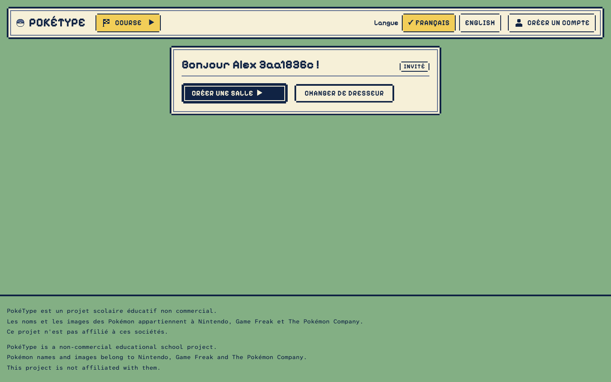
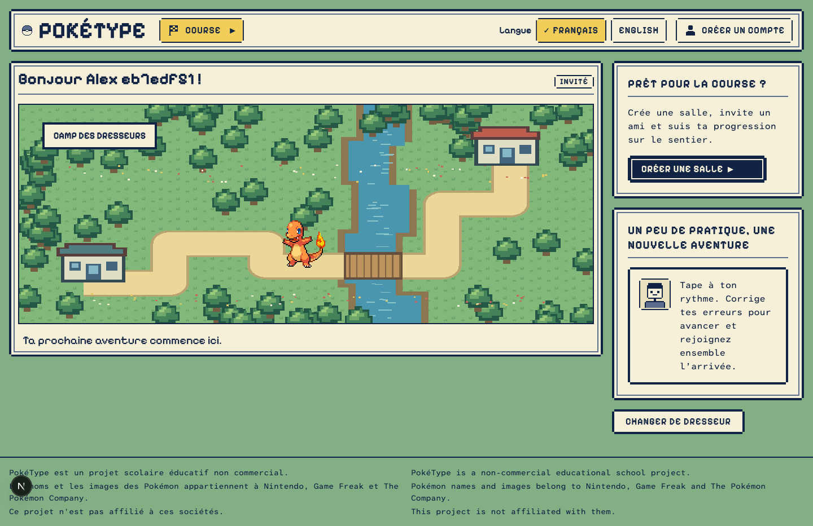
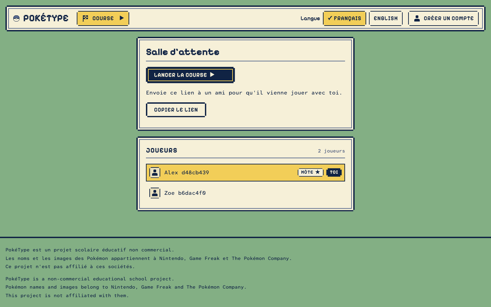
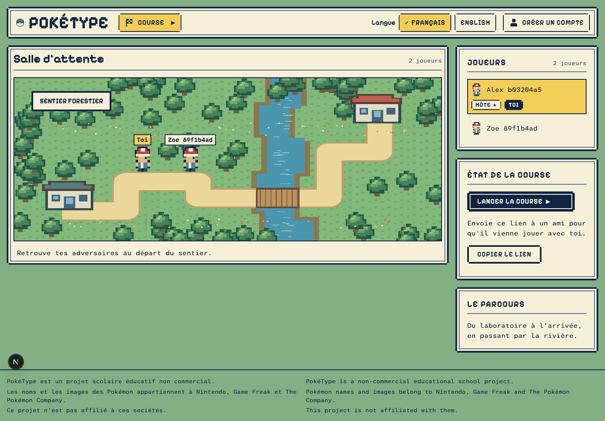
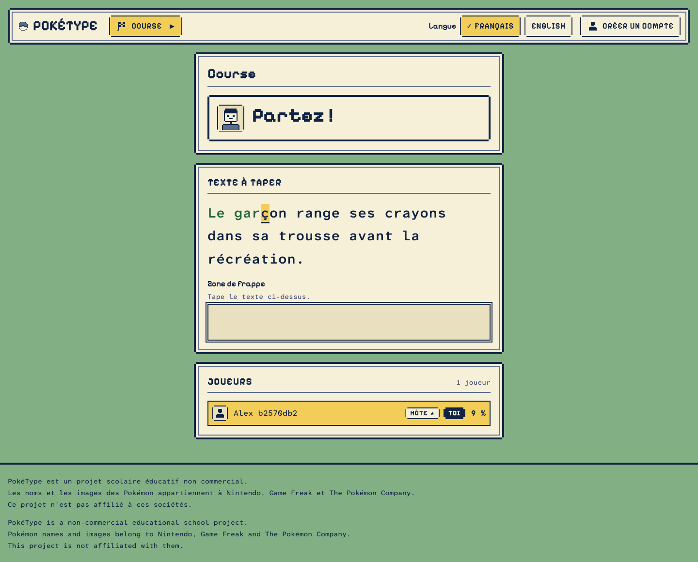
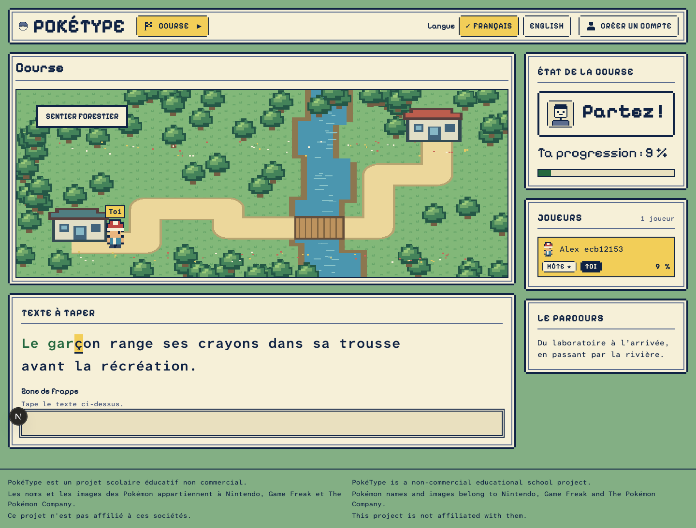
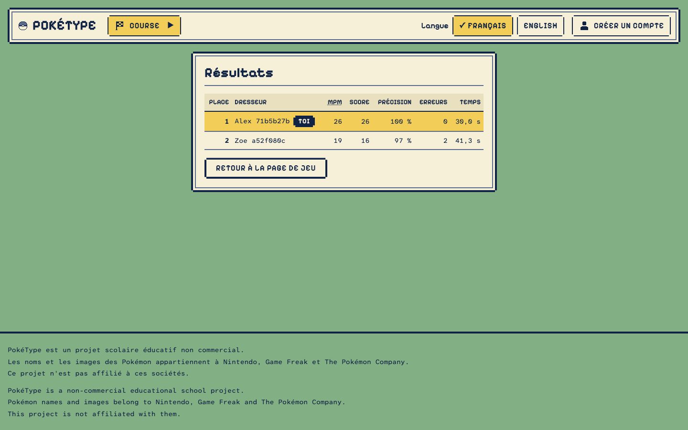
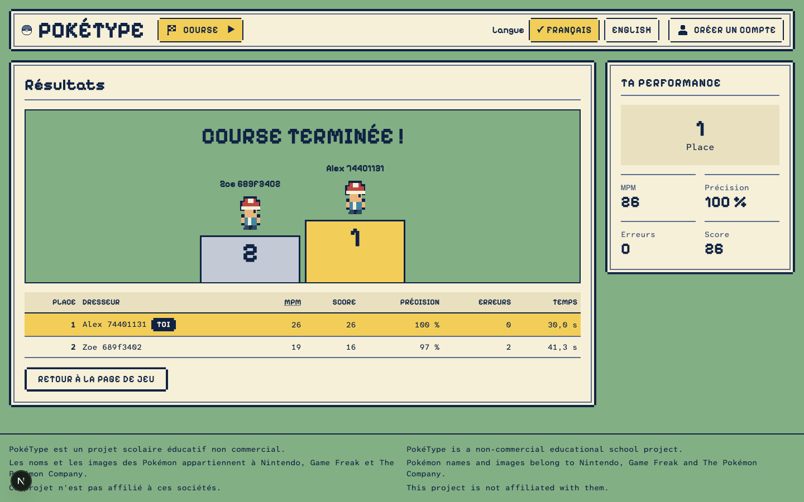

# UI foundation review — 2026-10-01

Local, uncommitted UI work. No commit or push was made.

The before captures are the existing pre-change Playwright screenshots preserved before editing. After captures are fresh browser renders of the changed implementation. Both use a 1440 × 900 desktop viewport; full-page heights and generated test trainer names differ. Mobile after captures are included at 320px and 375px.

## Changes

- Wide game layout, with a main scene and supporting sidebar; forms keep their narrow layout.
- Edge-to-edge scene panel variant, enlarged wordmark, compact bilingual footer.
- Original forest route with trainer positions derived from actual typing progress.
- Lobby scene and player roster; race passage beneath the map.
- Results podium and personal metrics from settled server results.
- Local sprite/scenery folders and a provenance manifest at `src/assets/manifest.ts`.

The trainer is temporary original art. Charmander is decorative, not an owned partner. The camp and lobby reuse the first environment. This is a layout and artwork foundation, not a complete reproduction of the detailed concept art; partner selection, XP, collections, evolution and rewards remain unimplemented.

## Validation

TypeScript, ESLint, 422 unit tests (one native-binding test rerun outside the sandbox), and 21 browser checks passed, including accessibility on the four changed screens and a full two-player race. Screens captured at 320, 375 and 1440 pixels. A final small-screen label adjustment was followed by another screenshot pass.

## Trainer camp

Before:

After:

## Lobby

Before:

After:

## Live race

Before:

After:

## Results

Before:

After:

